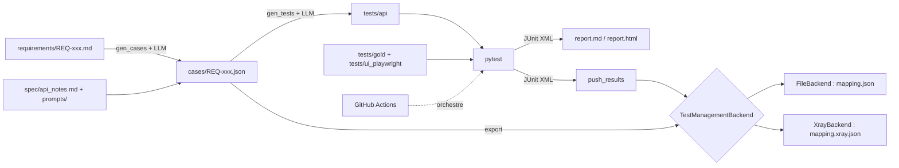
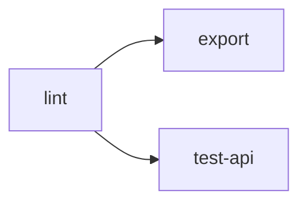

# QAPilot-AI

Pipeline QA complet piloté par IA, appliqué à *Restful Booker Platform*, une application de réservation d'hôtel lancée via Docker Compose.

> Projet réalisé par Imen Kammoun (ENIS), sujet 12 : « Pipeline QA complet piloté par IA ».
> La chaîne va de bout en bout : **exigences → cas de test (LLM) → export vers un outil de gestion → tests automatisés (API + UI) → intégration continue → rapport de synthèse**. Le projet met l'accent sur l'**orchestration** des étapes et sur la **reproductibilité**.

---

## Sommaire

1. [Idée directrice](#1-idée-directrice)
2. [Architecture](#2-architecture)
3. [Prérequis et installation](#3-prérequis-et-installation)
4. [Démarrage rapide](#4-démarrage-rapide)
5. [Les étapes de la chaîne en détail](#5-les-étapes-de-la-chaîne-en-détail)
6. [Commandes](#6-commandes)
7. [Structure du dépôt](#7-structure-du-dépôt)
8. [Intégration continue](#8-intégration-continue)
9. [Export vers un outil de gestion : FileBackend et Xray](#9-export-vers-un-outil-de-gestion--filebackend-et-xray)
10. [Résultats](#10-résultats)
11. [Comment interpréter les résultats](#11-comment-interpréter-les-résultats)
12. [Preuves de qualité du pipeline](#12-preuves-de-qualité-du-pipeline)
13. [Défauts applicatifs détectés](#13-défauts-applicatifs-détectés)
14. [Règles de travail](#14-règles-de-travail)
15. [Problèmes rencontrés et enseignements](#15-problèmes-rencontrés-et-enseignements)
16. [Dépannage](#16-dépannage)
17. [Étendre le projet](#17-étendre-le-projet)
18. [Limites et risques](#18-limites-et-risques)
19. [Perspectives](#19-perspectives)
20. [Glossaire](#20-glossaire)

---

## 1. Idée directrice

Un LLM sait écrire des cas de test et du code de test, mais il peut se tromper, et un test généré qui passe au vert ne prouve rien tant qu'on n'a pas vérifié ce qu'il contrôle. Le piège principal : le modèle peut **aligner un test sur le comportement défectueux de l'application** au lieu du comportement attendu, et valider ainsi un bug.

Le projet répond à ce risque par quatre principes :

| Principe | Mise en œuvre |
|---|---|
| **Le comportement attendu fait foi** | Les cas viennent des exigences. Les tests vérifient l'attendu, jamais l'observé défectueux. |
| **Des garde-fous automatiques** | `check_cases.py` et `check_tests.py` rejettent les cas et tests invalides (voir §5). |
| **Les défauts connus sont isolés** | Ils sont couverts par des tests écrits à la main (`tests/gold/`) et exécutés dans une suite séparée, non bloquante. |
| **Les chiffres ne viennent jamais du LLM** | Taux de réussite, durées, matrice de traçabilité : tout est calculé en Python à partir des fichiers JUnit. |

Autre choix structurant : le pipeline est **rejouable sans clé LLM**. Les cas et les tests générés sont commités après relecture humaine. `make all` rejoue donc toute la chaîne à partir de ces fichiers, ce qui rend l'exécution reproductible. L'appel au LLM est isolé dans `make regen`.

---

## 2. Architecture



Les deux étapes qui appellent le LLM (`gen_cases`, `gen_tests`) sont à gauche, en amont. Tout le reste (export, exécution, import des résultats, rapport) est déterministe et ne demande aucune clé.

---

## 3. Prérequis et installation

| Outil | Rôle |
|---|---|
| Python 3.12 et [uv](https://docs.astral.sh/uv/) | Environnement et dépendances verrouillées (`uv.lock`) |
| Docker Desktop (au moins 6 Go de RAM) | L'application sous test : 7 conteneurs |
| Make | Orchestration locale et en CI |
| Git avec sous-modules | L'application est un sous-module (`app/restful-booker-platform`) |
| Clé Groq | **Uniquement** pour `make regen` |
| Compte Jira Cloud + Xray | **Uniquement** pour `BACKEND=xray` (optionnel) |

Sous Windows, installe Make (par exemple avec `winget`). Le Makefile bascule automatiquement sur `cmd.exe`. Attention : dans un Makefile, les commandes commencent par une **tabulation**, pas par des espaces.

---

## 4. Démarrage rapide

### Rejeu complet (sans clé LLM)

```bash
git clone --recurse-submodules https://github.com/kammounimen/QAPilot-AI.git
cd QAPilot-AI
cp .env.example .env
uv sync
uv run playwright install chromium
make all
```

`make all` enchaîne : lint, démarrage de l'application, export des cas, tests API, tests UI, défauts connus, import des résultats, rapport. Compte environ 5 minutes la première fois, car le build Docker des 7 services et le démarrage Java (50 à 70 s par service) prennent du temps.

Sortie : `reports/report.md` et `reports/report.html`.

### Régénérer avec le LLM

```bash
# renseigner GROQ_API_KEY dans .env
make regen
```

Cette commande consomme le quota Groq et **réécrit** `cases/` et `tests/api/`. Relis les fichiers avant de les commiter.

### Variables d'environnement (`.env`)

| Variable | Usage |
|---|---|
| `GROQ_API_KEY`, `LLM_MODEL` | Génération (modèle par défaut : `openai/gpt-oss-120b`) |
| `BASE_URL` | URL de l'application (défaut : `http://localhost:8080`) |
| `BACKEND` | `file` (défaut) ou `xray` |
| `JIRA_URL`, `JIRA_USER`, `JIRA_API_TOKEN`, `JIRA_PROJECT_KEY` | Accès Jira (Xray uniquement) |
| `XRAY_CLIENT_ID`, `XRAY_CLIENT_SECRET` | Clé API Xray Cloud (Xray uniquement) |
| `PRICE_IN_PER_M`, `PRICE_OUT_PER_M` | Prix du modèle (USD par million de tokens) pour chiffrer le coût dans les métriques |

`.env` n'est **jamais** commité. `.env.example` ne contient aucune valeur.

---

## 5. Les étapes de la chaîne en détail

### 5.1 Exigences → cas de test (`pipeline/gen_cases.py`)

- Entrée : 12 fichiers `requirements/REQ-xxx.md` (identifiant, priorité, couche, description, critères d'acceptation) et `spec/api_notes.md` (endpoints, données, comportements attendus et observés).
- Un appel LLM **par exigence**, avec `temperature=0`, modèle épinglé, sortie JSON uniquement.
- Validation par des modèles Pydantic (`schemas/models.py`). En cas d'échec, **boucle de réparation** : l'erreur est renvoyée au modèle, 3 essais au maximum.
- Cache par hash (`.cache/llm/`) et journal des appels (`reports/llm_log.jsonl` : tokens, durée, version du prompt).
- Chaque essai est aussi journalisé dans `reports/validation_log.jsonl` (valide ou non, numéro d'essai), ce qui alimente la métrique « JSON valide au premier essai ».
- Les prompts sont versionnés (`prompts/v1`, `prompts/v2`). Le script choisit `v2` s'il existe.

### 5.2 Contrôle des cas (`pipeline/check_cases.py`)

Vérifie la structure des 35 cas, **un cas nominal et un cas négatif par exigence**, l'absence de doublon et l'absence d'orphelin (un cas sans exigence).

### 5.3 Export vers un outil de gestion (`pipeline/export.py`)

Voir §9. L'export est **idempotent** : le relancer ne crée aucun doublon.

### 5.4 Cas de test → tests API (`pipeline/gen_tests.py`)

Un fichier pytest par cas API, dans `tests/api/`. Le LLM renvoie `{"filename", "code"}` validé par Pydantic. Conventions imposées par le prompt : marqueur `@pytest.mark.tc("TC-...")`, `BASE_URL` en variable d'environnement, attentes explicites, aucun `sleep`, aucun docstring, **l'attendu du cas fait foi** et les données de test viennent des notes d'API.

### 5.5 Contrôle des tests (`pipeline/check_tests.py`)

Pour chaque fichier généré :

| Contrôle | Pourquoi |
|---|---|
| Compilation Python | Le LLM a déjà produit un docstring non fermé |
| Marqueur `@pytest.mark.tc(...)` présent | Sans lui, pas de traçabilité REQ → TC → test |
| Pas de `time.sleep` | Tests instables |
| Pas d'appel externe | Aucune dépendance hors application |
| `ruff` sans erreur | Qualité du code |
| **Aucun assert sur un code 5xx** | Signe qu'un test a été aligné sur un bug |

### 5.6 Tests écrits à la main (`tests/gold/`, `tests/ui_playwright/`)

- `tests/gold/` : tests de référence, défauts connus (`test_def_*`), couverture manquante. Ils servent aussi d'exemples au LLM.
- `tests/ui_playwright/` : 5 tests UI (connexion admin, formulaire de contact), avec des sélecteurs stables (`data-testid`, `#username`, `#doLogin`). Ils ont été enregistrés avec `playwright codegen` puis nettoyés à la main (ils ne sont **pas** générés par le LLM).

### 5.7 Exécution et traçabilité

Chaque test porte un marqueur `@pytest.mark.tc("TC-xxx-yy")`. Une fixture (`tests/conftest.py`) écrit cet identifiant dans le JUnit XML (`junit_family = "xunit1"`). C'est ce lien qui permet de reconstruire la matrice **exigence → cas → test → résultat**.

Trois fichiers JUnit sont produits :

| Fichier | Contenu | Bloquant ? |
|---|---|---|
| `reports/junit.xml` | Tests API (générés + gold sans défauts) | Oui |
| `reports/junit_ui.xml` | Tests UI Playwright | Oui |
| `reports/junit_defects.xml` | Tests de défauts connus | Non (rouges volontairement) |

### 5.8 Import des résultats (`pipeline/push_results.py`)

Fusionne les trois JUnit et envoie les résultats au backend choisi. Les tests dont l'identifiant ne correspond à aucun cas généré sont ignorés par Xray (voir §11).

### 5.9 Rapport (`pipeline/report.py`) et métriques (`pipeline/metrics.py`)

Le rapport (`report.md` et `report.html`) contient la synthèse, la matrice de traçabilité, la couverture par exigence, les échecs et défauts connus, et les tests hors cas générés. Les métriques (`reports/metrics.md`) donnent les appels LLM, les tokens, les durées, la validation JSON et la couverture. **Aucun chiffre ne vient du LLM.**

### 5.10 Reproductibilité (`pipeline/repro.py`)

`make repro` exécute deux fois la chaîne complète, calcule une empreinte SHA-256 de chaque exécution (cas, mapping, fichiers exportés, liste `(TC, test, statut)`, rapport sans les durées) puis compare.

---

## 6. Commandes

| Commande | Effet |
|---|---|
| `make all` | Rejoue tout : lint, démarrage, export, tests API et UI, défauts, import, rapport |
| `make up` / `make down` | Démarre (attend un vrai login) / arrête l'application et supprime les volumes |
| `make lint` | `ruff check .` |
| `make sync` | Exporte les cas, idempotent (`BACKEND=file` par défaut) |
| `make run` | Suite bloquante API : `tests/api` + `tests/gold` sans défauts |
| `make run-ui` | Suite UI Playwright |
| `make defects` | Tests de défauts connus, rouges volontairement, non bloquants |
| `make push` | Importe les résultats dans le backend |
| `make report` | Génère `report.md` et `report.html` |
| `make repro` | Deux exécutions complètes, puis comparaison des empreintes |
| `make regen` | Régénère cas et tests avec le LLM (`cases` + `gen-tests`) |
| `make sync BACKEND=xray` | Exporte les cas vers Jira/Xray |
| `make push BACKEND=xray` | Importe les résultats dans une Test Execution Xray |
| `uv run python -m pipeline.metrics` | Métriques LLM et couverture |
| `uv run pytest tests/unit -q` | Tests unitaires de `XrayBackend` (réponses simulées, sans réseau) |
| `uv run python check_connectivity.py` | Teste Jira et Xray à partir de `.env` (n'affiche aucun secret) |

---

## 7. Structure du dépôt

```
requirements/         Exigences REQ-001 à REQ-012
cases/                Cas de test générés (35), jamais modifiés à la main
tests/api/            Tests API générés (12 fichiers), jamais modifiés à la main
tests/gold/           Tests écrits à la main : défauts connus, couverture manquante
tests/ui_playwright/  Tests UI Playwright (5)
tests/unit/           Tests unitaires de XrayBackend (réponses simulées)
tests/conftest.py     Fixtures base_url, admin_token, TC-ID dans le JUnit, hook xfail
tests/known_gaps.py   Cas générés incohérents avec les exigences (marqués xfail)
spec/                 Notes d'API (api_notes.md) et registre des défauts (defects.md)
prompts/v1, v2        Prompts versionnés du générateur
schemas/              Modèles Pydantic (Requirement, TestCase, Step...)
pipeline/             Génération, contrôle, export, import, rapport, métriques, repro
backends/             Interface TestManagementBackend, FileBackend, XrayBackend
scripts/              wait_for_app.py (attend un vrai login avant les tests)
docker/               Dockerfiles des services
docker-compose.yml    Les 7 services de l'application
app/                  Sous-module restful-booker-platform (non modifié)
mapping.json          Correspondance TC-ID ↔ clé (FileBackend), suivie par Git
mapping.xray.json     Correspondance TC-ID ↔ clé Jira (XrayBackend), suivie par Git
.github/workflows/    CI (ci.yml)
reports/              Sorties générées (ignorées par Git)
```

---

## 8. Intégration continue

Fichier : `.github/workflows/ci.yml`, déclenché sur `push`, `pull_request` et `workflow_dispatch`.



| Job | Contenu |
|---|---|
| `lint` | `ruff`, `check_cases`, `check_tests` |
| `export` | Deux passages de `make sync`, puis vérification qu'il reste exactement 35 fichiers : la CI **prouve elle-même l'idempotence** |
| `test-api` | Démarre les 7 services, installe Chromium, lance `make run`, `make run-ui`, `make defects`, `make push`, `make report`, publie le rapport dans le résumé du job |

Bonnes pratiques appliquées : permissions minimales (`contents: read`), `concurrency` (annule les runs obsolètes), cache `uv`, `timeout-minutes`, `if: always()` sur les étapes de rapport pour qu'un échec produise quand même ses artefacts, et logs Docker en cas d'échec.

Artefacts : `api-results` (dossier `reports/`, dont `junit*.xml`, `report.md`, `report.html`, fichier d'exécution) et `export-results` (`mapping.json`, `reports/xray_mock/`).

Un run complet dure environ 4 minutes. La CI n'utilise **ni clé LLM ni compte Jira** : elle rejoue les fichiers commités.

Si le nombre de cas change, mets à jour la valeur `35` de l'étape « Vérifier l'absence de doublon ».

---

## 9. Export vers un outil de gestion : FileBackend et Xray

Tous les backends implémentent la même interface (`backends/base.py`) :

```python
class TestManagementBackend(ABC):
    def find_by_external_id(self, external_id: str) -> str | None: ...
    def create_test(self, case: dict) -> str: ...
    def update_test(self, key: str, case: dict) -> None: ...
    def import_results(self, results: list[dict]) -> str: ...
```

### 9.1 L'idempotence

Pour chaque cas, l'export cherche d'abord une clé dans le fichier de correspondance. À défaut, il interroge le backend par identifiant externe. S'il trouve le test, il le **met à jour** ; sinon il le **crée**. Un second lancement ne crée donc rien. Le fichier de correspondance est écrit après chaque cas : une interruption en cours d'export ne laisse pas de doublon à la relance.

### 9.2 FileBackend (par défaut)

Écrit un JSON par test dans `reports/xray_mock/tests/` et un fichier d'exécution `EXEC-*.json`. Il ne demande aucun compte, ce qui garantit un pipeline rejouable partout.

### 9.3 XrayBackend (Jira Cloud + Xray)

- Chaque cas devient un ticket Jira de type `Test`, avec le TC-ID et l'exigence en **labels**. La recherche d'un test existant se fait par JQL sur ce label (`labels = "TC-001-01"`).
- Les résultats sont importés dans une **Test Execution** via l'API JSON d'import d'Xray (`/api/v2/import/execution`) après échange du `client_id` et du `client_secret` contre un jeton JWT.
- Correspondance des statuts : `passed → PASSED`, `failed → FAILED`, `xfail` et `skipped → TODO`. Quand un même cas est porté par plusieurs tests (par exemple un test généré et un test gold), le statut le plus sévère l'emporte : `FAILED` > `PASSED` > `TODO`.
- Les tests sans cas généré correspondant (TC-ID suffixés `b`) n'ont pas de ticket Jira et sont ignorés à l'import.
- Les réponses sont simulées dans `tests/unit/`, ce qui permet de tester le backend sans compte Jira.

Configuration :

1. Créer un site Jira Cloud et un projet, installer Xray (essai gratuit).
2. Ajouter les types `Test` et `Test Execution` au **schéma de types de tickets du projet** (Paramètres du projet → Types de ticket). Sans cela, Jira répond « Spécifiez un type de ticket valide ».
3. Créer un token API Jira et une clé API Xray (client id et secret), à renseigner dans `.env`.
4. Vérifier : `uv run python check_connectivity.py`.
5. Exporter : `make sync BACKEND=xray` (deux fois : la seconde doit afficher `0 créés, 35 mis à jour`).
6. Importer les résultats : `make run`, `make run-ui`, `make defects`, puis `make push BACKEND=xray`.

Xray **n'est pas exécuté en CI** : il exige un compte actif et des secrets, et `main` doit rester vert sans Jira. Il a été validé manuellement (voir §12).

---

## 10. Résultats

### Vue d'ensemble

| Indicateur | Valeur |
|---|---|
| Exigences | 12 |
| Cas de test | 35 (13 API, 22 UI) |
| Cas automatisés | **16 / 35** (API 13 / 13, UI 3 / 22) |
| Tests API (suite bloquante) | 17 exécutés : 14 réussis, 3 xfail, 0 échec |
| Tests UI Playwright | 5 réussis |
| Tests de défauts connus | 3 échecs voulus (DEF-001, DEF-002) |
| Tests importés dans le backend | 25 (17 + 5 + 3) |
| Suite bloquante du rapport | 22 tests : 19 réussis, 3 xfail, 0 échec, taux de réussite 100 % |
| Exigences avec cas nominal et négatif | 12 / 12 |
| CI (`main`) | verte, 3 jobs, environ 4 minutes |

### Xray

| Élément | Valeur |
|---|---|
| Tests créés dans Jira | 35, sans doublon |
| Relance sans fichier de correspondance | `0 créés, 35 mis à jour` : la recherche par label suffit |
| Test Execution importée | QAP-36 : **12 PASSED, 1 FAILED, 3 TO DO**, 16 tests |

### Appels LLM (historique de développement)

| Prompt | Appels | Tokens en entrée | Tokens en sortie | Durée cumulée |
|---|---|---|---|---|
| v1 | 146 | 195 644 | 90 059 | 741,4 s |
| v2 | 26 | 51 848 | 10 697 | 212,4 s |
| **Total** | **172** | **247 492** | **100 756** | **953,8 s** |

---

## 11. Comment interpréter les résultats

### 11.1 Lire le rapport

Chaque cas de la matrice a un statut :

| Statut | Signification |
|---|---|
| **réussi** | Tous les tests qui portent ce TC-ID passent. Un cas couvert par un test généré **et** un test gold n'est réussi que si les deux passent. |
| **xfail (écart de génération)** | Le cas généré est incohérent avec les exigences. Il est marqué « échec attendu » dans `tests/known_gaps.py` sans toucher aux fichiers générés. |
| **défaut connu** | Le test échoue parce que l'**application** est défectueuse (DEF-001, DEF-002). |
| **échec** | Un test de la suite bloquante échoue : régression. La CI passe au rouge. |
| **non automatisé** | Aucun test ne porte ce TC-ID (aujourd'hui : cas UI). |

### 11.2 Ce que signifie « 100 % de réussite »

Le taux est calculé comme `réussis / (réussis + échoués)` sur la **suite bloquante**. Il vaut 100 % parce que les 3 xfail et les 3 défauts connus sont suivis **à part**, ce qui est voulu mais doit être dit clairement. Il ne signifie pas « l'application est sans défaut » : le rapport liste précisément 2 défauts réels. Il signifie « aucun test attendu vert ne passe au rouge ».

### 11.3 Pourquoi 16 cas dans Xray alors qu'il y a 25 tests

Xray reçoit 25 tests, mais seuls ceux dont le TC-ID correspond à un cas généré ont un ticket Jira. Les tests `TC-001-01b`, `TC-001-02b` (UI de connexion) et `TC-012-02b`, `TC-012-03b`, `TC-012-04b` (gold) n'ont pas de cas d'origine : ils sont listés dans la section « Tests gold hors cas générés » du rapport, mais ne sont pas envoyés. Le tableau de bord Xray affiche donc 16 tests, soit les 16 cas automatisés :

| Xray | Origine |
|---|---|
| 12 PASSED | Cas dont tous les tests passent |
| 1 FAILED | TC-001-04, le défaut DEF-001 |
| 3 TO DO | Les 3 xfail : TC-002-03, TC-012-01, TC-012-02 |

DEF-002 (messages accessibles sans jeton) apparaît dans le rapport mais pas dans Xray, car ses tests sont des tests gold sans cas d'origine.

### 11.4 Lire les métriques

- **172 appels** couvrent tout l'historique de développement (essais, régénérations), pas un seul run propre. Les appels servis par le cache ne sont pas journalisés.
- La durée moyenne passe de 5,08 s (v1) à 8,17 s (v2) : le prompt v2 est plus long et plus contraint.
- Le **coût** reste « n/a » tant que `PRICE_IN_PER_M` et `PRICE_OUT_PER_M` ne sont pas renseignés : le pipeline n'invente pas de prix.
- La métrique « JSON valide au premier essai » n'est alimentée que depuis l'ajout de `validation_log` ; elle se remplit à la prochaine régénération.

---

## 12. Preuves de qualité du pipeline

### 12.1 Détection d'une régression (branche `bug-injection`)

Le service `room` a été volontairement arrêté dans `docker-compose.yml`, sur une branche dédiée. Résultat : l'application démarre, les tests de connexion restent verts, mais plusieurs tests qui lisent les chambres échouent (par exemple `test_get_room_list_with_valid_token`). **La CI passe au rouge** (run #17), tandis que le rapport et les artefacts sont produits quand même. La branche n'est jamais fusionnée dans `main` ; elle reste comme preuve.

Lecture : le pipeline ne se contente pas de passer, il **détecte** une panne réelle et indique quels cas sont touchés.

### 12.2 Reproductibilité (`make repro`)

Deux exécutions complètes donnent des empreintes **identiques** sur : 12 fichiers de cas, 35 tests exportés, 20 résultats `(TC, test, statut)` et le rapport sans les durées. La sortie finale est `IDENTIQUE : les deux exécutions sont reproductibles`.

Ce que cela prouve : à partir des fichiers commités, l'export, l'exécution, l'import et le rapport sont déterministes. Ce que cela ne prouve pas : que le LLM régénère exactement les mêmes cas (voir §18).

### 12.3 Idempotence de l'export

| Test | Résultat attendu et observé |
|---|---|
| `make sync` deux fois (FileBackend) | `35 créés`, puis `0 créés, 35 mis à jour`, 35 fichiers |
| Même vérification en CI | Étape « Vérifier l'absence de doublon » verte |
| `make sync BACKEND=xray` deux fois | `35 créés`, puis `0 créés, 35 mis à jour`, 35 Tests dans Jira |
| Relance Xray **sans** `mapping.xray.json` | `0 créés, 35 mis à jour` : les Tests sont retrouvés par label |

---

## 13. Défauts applicatifs détectés

Détail dans `spec/defects.md`.

| ID | Endpoint | Attendu | Observé | Gravité | Test |
|---|---|---|---|---|---|
| DEF-001 | `POST /api/auth/login` avec un JSON invalide | 400 | 500 | Mineure | TC-001-04 |
| DEF-002 | `GET /api/message` sans jeton ou avec un jeton invalide | 401 ou 403 (REQ-012) | 200 et liste des messages | Moyenne à haute | TC-012-02b, TC-012-03b |

Autres constats : Swagger (`/swagger-ui.html`, `/v3/api-docs`) activé sous le profil `prod`, identifiants par défaut `admin` / `password`, format d'erreur incohérent entre `/api/auth/login` (`error`) et `/api/room` (`errors`).

### Écarts de génération (pas des défauts de l'application)

TC-002-03, TC-012-01 et TC-012-02 attendent 401 ou 403 sur `GET /api/room`. Or REQ-002 décrit une liste de chambres visible par un visiteur (donc publique), et REQ-012 ne protège que la création, la modification, la suppression de chambres et la lecture des messages. Ces cas sont une **erreur du LLM**, marquée `xfail` via `tests/known_gaps.py`. Distinguer un défaut de l'application d'une erreur de génération est précisément le rôle de la classification du rapport.

---

## 14. Règles de travail

- Ne jamais modifier `cases/` ni `tests/api/` à la main. Les décisions vont dans `spec/`, `prompts/`, `tests/known_gaps.py` ou `tests/gold/`.
- Les tests vérifient le comportement attendu par les exigences, jamais l'observé défectueux. Les défauts connus sont couverts par des tests gold écrits à la main.
- Le comportement attendu du cas fait foi ; les données de test viennent des notes d'API (`prompts/v2/gen_tests_api.md`).
- Un test vert ne prouve rien tant que son assert n'a pas été lu.
- Ne pas régénérer sans raison : le LLM varie d'un run à l'autre et le quota Groq est limité (200 000 tokens par jour).
- Ne jamais commiter `.env`. Ne jamais modifier le sous-module `app/`.

---

## 15. Problèmes rencontrés et enseignements

| Problème | Cause | Solution |
|---|---|---|
| Tests skippés « endpoint non documenté » | Cas ambigus, spec contradictoire | Spec consolidée, une section par endpoint |
| Tests verts mais faux (`GET /api/room` → 200) | Le modèle alignait le test sur les notes | Règle v2 : l'attendu du cas fait foi |
| Faux rouges (mauvais mot de passe, `roomid` 101) | Données inventées dans les cas | Règle v2 : données issues des notes |
| `TC-001-04` assertée `== 500` | Le modèle a pris l'observé pour l'attendu | Test gold à la main et garde-fou 5xx |
| Fichier généré avec docstring non fermé | Variabilité du LLM | `compileall` et interdiction des docstrings dans le prompt |
| Erreur 429 Groq | Quota quotidien de tokens atteint | Changer de modèle, attendre, ne régénérer que si nécessaire |
| Premier login en timeout en CI | Le port 8080 répond avant que le service `auth` ait démarré | `wait_for_app.py` attend un vrai login (200) |
| Suite bloquante toujours rouge | Les tests de défauts échouent par nature | Séparation `make run` / `make defects` (`-` ignore l'échec) |
| TC-ID absents du JUnit | Format `xunit2` n'écrit pas `record_property` | `junit_family = "xunit1"` |
| `missing separator` dans le Makefile | Tabulations converties en espaces | Makefile généré avec de vraies tabulations |
| Jira : « Spécifiez un type de ticket valide » | `Test` et `Test Execution` absents du schéma du projet | Ajout des types au schéma de types de tickets |

---

## 16. Dépannage

| Symptôme | Cause probable | Action |
|---|---|---|
| `ReadTimeout` sur `localhost:8080` | Les conteneurs viennent de redémarrer (50 à 70 s par service Java) | `uv run python scripts/wait_for_app.py`, puis relancer |
| `make run` rouge juste après un redémarrage de Docker | Même cause | Attendre l'application avant de lancer les tests |
| `*** missing separator` | Tabulations perdues dans le Makefile | Réécrire le fichier avec de vraies tabulations |
| `Result is not valid Xray Format` | Statut non reconnu (`PASS` au lieu de `PASSED`) ou JSON mal formé | Vérifier le payload d'import |
| `make sync BACKEND=xray` : 401 | Token Jira ou email faux | `uv run python check_connectivity.py` |
| Variable lue comme `JIRA_PROJECT_KEY=QAP` | Nom de variable répété dans `.env` | Une seule fois `NOM=valeur`, sans guillemets |
| Conflit d'enregistrement VS Code | Fichier modifié sur disque pendant qu'il était ouvert | Choisir « Revert », pas « Overwrite » |
| `make cases` réécrit les cas | Appels réels au LLM | À éviter hors `make regen` |

---

## 17. Étendre le projet

### Ajouter un backend de gestion de tests

1. Créer `backends/mon_backend.py` avec une classe qui implémente les quatre méthodes de `TestManagementBackend`.
2. L'enregistrer dans `get_backend()` de `pipeline/export.py` et ajouter son fichier de correspondance dans `MAPPINGS`.
3. Écrire des tests unitaires avec des réponses simulées (voir `tests/unit/test_xray_backend.py`).
4. Lancer `make sync BACKEND=mon_backend` deux fois pour prouver l'idempotence.

### Automatiser un cas UI de plus

1. Lancer `uv run playwright codegen --target python-pytest -o scratch/codegen.py http://localhost:8080/admin` (le dossier `scratch/` est ignoré par Git).
2. Transformer l'enregistrement en test propre : marqueur `@pytest.mark.tc("TC-xxx-yy")`, attentes explicites, `base_url`, aucun `sleep`.
3. Le placer dans `tests/ui_playwright/` et vérifier avec `make run-ui`.
4. Vérifier le passage de `Cas UI automatisés` dans le rapport.

### Mesurer le coût

Renseigner `PRICE_IN_PER_M` et `PRICE_OUT_PER_M` (prix du modèle, USD par million de tokens) puis lancer `uv run python -m pipeline.metrics`.

---

## 18. Limites et risques

- **Hallucinations** : le LLM a produit des cas incohérents (TC-002-03, TC-012-01, TC-012-02). Ils sont marqués `xfail` et une relecture humaine des cas reste nécessaire avant de les commiter.
- **Reproductibilité** : elle porte sur le **rejeu des artefacts commités**. La génération utilise `temperature=0`, un modèle épinglé et un cache par hash, mais le texte exact n'est pas garanti d'un run à l'autre.
- **Coût et quota** : 172 appels, environ 247 000 tokens en entrée et 101 000 en sortie sur l'historique de développement, avec un quota quotidien limité. Le coût n'est pas chiffré tant que les prix ne sont pas renseignés.
- **Données envoyées au LLM** : exigences et notes d'API uniquement, aucun secret ni donnée personnelle.
- **Couverture UI limitée** : 3 cas sur 22 sont automatisés. Les 19 autres ne sont pas encore traités, et le tri entre cas à automatiser et cas manuels reste à documenter.
- **Tests UI non générés par le LLM** : ils viennent de Playwright codegen, nettoyés à la main. La génération IA couvre les cas et les tests API.
- **Effets de bord UI** : le test d'envoi du formulaire de contact crée de vrais messages dans l'application. `make down` (volumes supprimés) remet l'état à zéro.
- **Xray hors CI** : il est validé manuellement mais pas rejoué en CI (compte et secrets nécessaires). L'essai Xray est limité dans le temps (au moins 30 jours, non prolongeable) ; les tickets Jira restent visibles, mais l'application peut être désactivée à la fin de l'essai.
- **Xray ignore certains tests** : les tests sans cas généré (suffixe `b`) n'ont pas de ticket, donc DEF-002 apparaît dans le rapport mais pas dans Xray.
- **Statuts Xray** : les `xfail` sont envoyés en `TODO`, faute de statut équivalent.
- **Métrique « JSON valide au premier essai »** : journalisée seulement depuis l'ajout de `validation_log`. L'historique antérieur n'est pas rejouable.
- **Taux de réussite** : le 100 % exclut les xfail et les défauts connus (voir §11.2).
- **Dépendance externe** : les images Docker et les dépendances Maven et npm sont téléchargées à la construction ; les actions GitHub ciblent encore Node 20 (avertissement de dépréciation).

---

## 19. Perspectives

- Génération LLM des tests UI à partir des tests gold Playwright (prompt `gen_tests_pw.md`).
- Documenter le tri des cas UI manuels et automatiser les cas prioritaires (déconnexion, création de chambre).
- Selenium en smoke (4 à 6 scénarios) et comparaison Playwright / Selenium.
- Stories Jira liées aux exigences, et liens Tests ↔ Stories dans Xray.
- Matrice Playwright (Chromium, Firefox) et `nightly.yml` pour détecter les tests instables.
- `Jenkinsfile.example` pour montrer la portabilité : la CI n'est qu'un enchaînement de cibles `make`.
- `ZephyrBackend`, BDD, OpenTelemetry avec Jaeger, LLM-as-judge pour noter la pertinence des cas.
- Règle dans `gen_cases` : pas de cas 401/403 sur un endpoint public, puis régénération et suppression de `known_gaps.py`.

---

## 20. Glossaire

| Terme | Définition |
|---|---|
| **REQ** | Exigence (`REQ-001`) décrite en Markdown |
| **TC** | Cas de test (`TC-001-01`), dérivé d'une exigence |
| **Test gold** | Test écrit à la main, qui sert de référence ou couvre un défaut connu |
| **xfail** | « Échec attendu » : un test volontairement marqué comme devant échouer |
| **Défaut connu** | Échec dû à l'application (DEF-001, DEF-002), suivi dans une suite séparée |
| **Écart de génération** | Cas incohérent produit par le LLM, sans lien avec un bug de l'application |
| **Idempotence** | Relancer une opération ne produit pas de doublon |
| **FileBackend / XrayBackend** | Implémentations de l'interface de gestion de tests |
| **Test Execution** | Objet Xray qui regroupe les résultats d'une exécution |
| **JUnit XML** | Format standard de résultats de tests, lu par le rapport et par Xray |