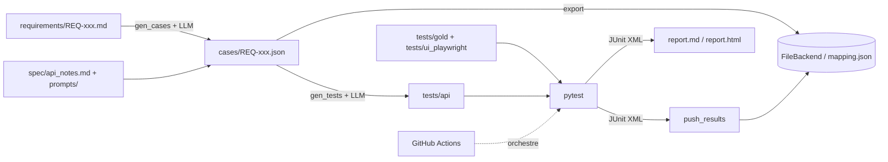

# QAPilot-AI

Pipeline QA complet piloté par IA, appliqué à *Restful Booker Platform* (application de réservation d'hôtel lancée via Docker Compose).

Chaîne de bout en bout : **exigences → cas de test (LLM) → export vers un outil de gestion → tests automatisés (API + UI) → CI → rapport de synthèse**, avec des garde-fous pour que les tests générés ne valident pas un comportement défectueux.

## Architecture



| Étape | Module | Rôle |
|---|---|---|
| Génération des cas | `pipeline/gen_cases.py` | Un appel LLM par exigence, validation Pydantic, 3 essais max |
| Contrôle des cas | `pipeline/check_cases.py` | Structure, un cas nominal et un négatif par exigence |
| Export | `pipeline/export.py`, `backends/` | Interface `TestManagementBackend`, `FileBackend`, idempotence, `mapping.json` |
| Génération des tests | `pipeline/gen_tests.py` | Un fichier pytest par cas API |
| Contrôle des tests | `pipeline/check_tests.py` | Compilation, marqueur `tc`, ruff, pas de `sleep`, pas d'assert sur 5xx |
| Résultats | `pipeline/push_results.py` | Fusion des JUnit, import dans le backend |
| Rapport | `pipeline/report.py` | Taux, matrice REQ → TC → test → résultat, défauts |
| Métriques | `pipeline/metrics.py` | Appels LLM, tokens, durées, couverture |
| Reproductibilité | `pipeline/repro.py` | Empreintes SHA-256 de deux exécutions et comparaison |

Tous les chiffres du rapport sont calculés en Python, jamais par le LLM.

## Prérequis

- Python 3.12 et [uv](https://docs.astral.sh/uv/)
- Docker Desktop
- Make
- Une clé Groq, uniquement pour régénérer les cas ou les tests

## Démarrage rapide (rejeu, sans clé LLM)

```bash
git clone --recurse-submodules <ton-depot>
cd QAPilot-AI
cp .env.example .env
uv sync
uv run playwright install chromium
make all
```

`make all` rejoue le pipeline à partir des cas et tests commités : lint, démarrage de l'application (environ 70 s pour le service auth), export, tests API, tests UI, défauts connus, import des résultats, rapport. Sortie : `reports/report.md` et `reports/report.html`.

Pour régénérer avec le LLM (consomme le quota Groq et réécrit `cases/` et `tests/api/`) :

```bash
make regen
```

## Commandes

| Commande | Effet |
|---|---|
| `make up` / `make down` | Démarre (avec attente du login réel) / arrête l'application |
| `make sync` | Exporte les cas (idempotent) |
| `make run` | Suite bloquante API (`tests/api` + `tests/gold` sans défauts) |
| `make run-ui` | Suite UI Playwright |
| `make defects` | Tests de défauts connus, rouges volontairement, non bloquants |
| `make push` | Importe les résultats dans le backend |
| `make report` | Génère `report.md` et `report.html` |
| `make repro` | Deux exécutions complètes puis comparaison des empreintes |
| `make regen` | Régénère cas et tests avec le LLM |

## Structure

```
requirements/       Exigences REQ-001 à REQ-012
cases/              Cas générés (35), ne jamais modifier à la main
tests/api/          Tests API générés (ne pas modifier à la main)
tests/gold/         Tests écrits à la main (défauts connus, couverture manquante)
tests/ui_playwright/ Tests UI Playwright (5)
tests/known_gaps.py Cas générés incohérents avec les exigences (xfail)
spec/               Notes d'API, défauts
prompts/v1, v2      Prompts versionnés
backends/           Interface et FileBackend
pipeline/           Génération, contrôle, export, rapport, métriques
.github/workflows/  CI
```

## CI (GitHub Actions)

Jobs : `lint` → `export` (deux passages, vérification de l'absence de doublon) et `test-api` (application Docker, API, UI Playwright, défauts, import, rapport dans le résumé du job). Artefacts : `api-results`, `export-results`. Permissions minimales, `concurrency`, cache uv.

## Résultats actuels

- 12 exigences, 35 cas (13 API, 22 UI)
- Cas automatisés : 16 / 35 (API 13 / 13, UI 3 / 22)
- Suite bloquante : 19 réussis, 3 xfail, 0 échec ; UI : 5 réussis
- 2 défauts applicatifs réels, 3 tests rouges volontaires (voir `spec/defects.md`) :
  - DEF-001 : `POST /api/auth/login` avec JSON invalide renvoie 500 au lieu de 400
  - DEF-002 : `GET /api/message` sans jeton renvoie 200 au lieu de 401/403
- Preuve de détection : branche `bug-injection` (service `room` arrêté), CI rouge
- Preuve de reproductibilité : `make repro` donne « IDENTIQUE »

## Règles de travail

- Ne jamais modifier `cases/` ni `tests/api/` à la main : les décisions vont dans `spec/`, `prompts/`, `tests/known_gaps.py` ou `tests/gold/`.
- Les tests vérifient le comportement attendu par les exigences, jamais l'observé défectueux.
- Un test vert ne prouve rien tant que son assert n'a pas été lu.
- Ne pas régénérer sans raison : le LLM varie d'un run à l'autre et le quota Groq est limité.

## Limites et risques

- **Hallucinations** : le LLM a produit des cas incohérents (TC-002-03, TC-012-01, TC-012-02 supposent `GET /api/room` protégé alors qu'il est public). Ils sont marqués xfail, et une relecture humaine reste nécessaire.
- **Reproductibilité** : elle porte sur le rejeu des artefacts commités. La génération LLM utilise `temperature=0`, un modèle épinglé et un cache par hash, mais le texte exact n'est pas garanti d'un run à l'autre.
- **Coût et quota** : 172 appels, environ 247 000 tokens en entrée et 101 000 en sortie sur l'historique, avec un quota quotidien Groq limité. Le coût n'est pas chiffré tant que les prix ne sont pas renseignés.
- **Données envoyées au LLM** : exigences et notes d'API uniquement, aucun secret ni donnée personnelle.
- **Couverture UI limitée** : 3 cas sur 22 automatisés. Les tests UI actuels viennent de Playwright codegen puis d'un nettoyage manuel, pas de la génération LLM.
- **Instabilité UI** : sélecteurs `data-testid`, mais le test d'envoi de contact crée de vrais messages dans l'application.
- **Outil de gestion de tests** : seul le `FileBackend` est implémenté et testé. Xray n'est pas branché.
- **Métrique « JSON valide au 1er essai »** : journalisée seulement depuis l'ajout de `validation_log`. L'historique antérieur n'est pas rejouable.
- **Taux de réussite de 100 %** : il exclut les 3 xfail et les défauts connus, suivis à part.

## Perspectives

XrayBackend et ZephyrBackend, génération LLM des tests UI à partir des tests gold Playwright, Selenium (smoke), Jenkins, BDD, OpenTelemetry.